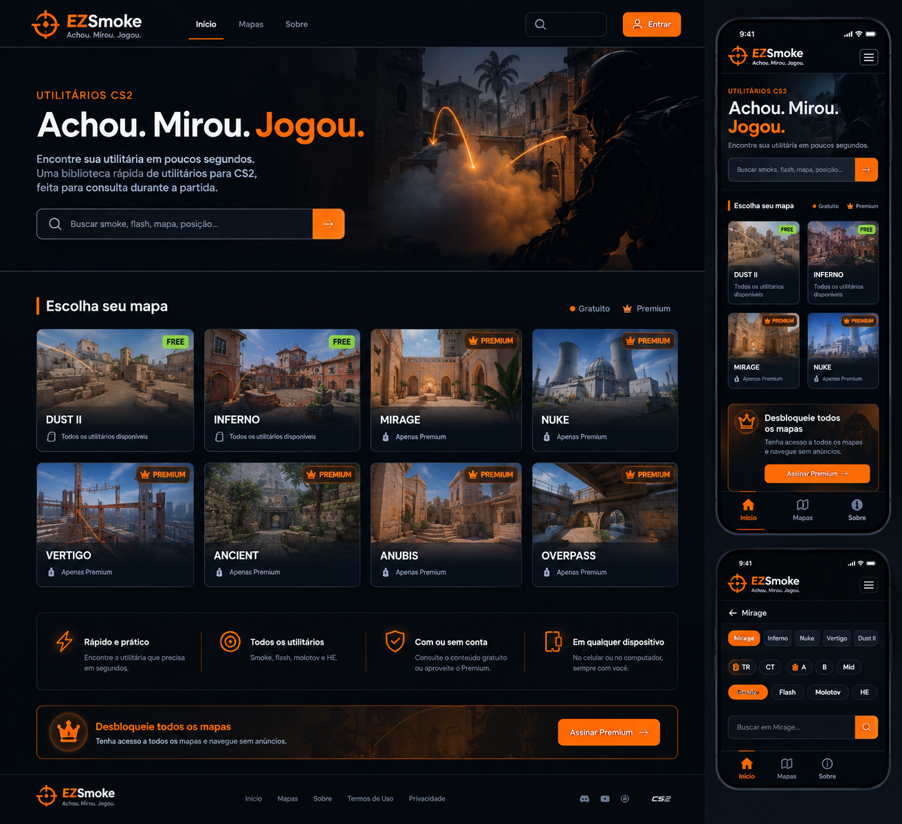

# EZSmoke

> **Achou. Mirou. Jogou.**

O **EZSmoke** é uma biblioteca rápida de utilitárias para **Counter-Strike 2 (CS2)**, criada para consulta durante a partida.

A proposta é simples:

> **Abriu → encontrou a utilitária → executou.**

O projeto não tem como objetivo ser uma plataforma de treinamento, curso ou comunidade. O foco é oferecer uma experiência rápida, objetiva e fácil de consultar, principalmente em dispositivos móveis.

---

## 📌 Status do projeto

**Fase atual:** Planejamento e definição da arquitetura — **revisão v2**.

A interface, regras de negócio, modelo de banco de dados e arquitetura foram definidos e revisados. A implementação ainda não foi iniciada.

O schema SQL de referência está em [`database/schema.sql`](database/schema.sql).

As mudanças desta revisão estão resumidas em [Revisão v2](#-revisão-v2--31102026), no final do documento.

---

## 🎯 Objetivo

O EZSmoke resolve um problema simples: durante uma partida, o jogador pode precisar consultar rapidamente uma smoke, flash, molotov ou HE.

Em vez de navegar por várias páginas, o usuário deve conseguir:

```text
Buscar → Encontrar → Executar
```

A experiência deve ser rápida o suficiente para não atrapalhar o ritmo da partida.

---

## 💡 Proposta

O EZSmoke será uma biblioteca de utilitárias organizada por:

- Mapa
- Lado (TR / CT)
- Região (A / B / MID)
- Área (callout, ex.: Jungle, Banana, Long)
- Tipo de utilitária
- Busca textual

Tipos de utilitária inicialmente suportados:

- Smoke
- Flash
- Molotov
- HE

### Terminologia

O projeto usa **"utilitária"** (feminino) em toda a interface e documentação. Textos como "Todos os utilitários" ou "Utilitários CS2" na referência visual devem ser ajustados para "Todas as utilitárias" / "Utilitárias CS2".

---

# 🧭 Experiência do usuário

## Home

A Home será limpa e objetiva.

Elementos principais:

- Logo EZSmoke
- Slogan
- Busca principal
- Cards dos mapas

Não haverá, no MVP:

- Notícias
- Blog
- Feed
- Ranking
- XP
- Cursos
- Conteúdo desnecessário

### Busca

A busca é um dos principais elementos do produto.

Exemplos:

```text
mirage jungle
smoke jungle
dust xbox
inferno banana
flash b
mirage smoke a
```

O sistema deve conseguir encontrar resultados relevantes sem exigir que o usuário conheça o nome exato da lineup. Ver [Busca](#-busca) para o funcionamento.

---

# 🗺️ Mapas

No lançamento, o modelo de acesso será:

### Free

- Dust II
- Inferno

Esses mapas terão o conteúdo completo disponível gratuitamente.

### Premium

Os demais mapas serão Premium:

- Mirage
- Nuke
- Vertigo
- Ancient
- Anubis
- Overpass

A estrutura será preparada para adicionar novos mapas posteriormente, já que o map pool competitivo do CS2 muda com o tempo. A ordem de exibição é controlada pelo campo `sort_order`.

### Conteúdo de lançamento

O conteúdo é o principal gargalo do projeto, não o código. Meta de lançamento:

- **Dust II e Inferno completos**: cerca de 20–30 lineups cada
- **2 a 3 mapas Premium** já com conteúdo relevante

Um mapa Premium com poucas lineups frustra quem pagou. É melhor lançar menos mapas Premium, porém bem cobertos.

---

# 🔎 Página do mapa

Ao entrar em um mapa, **todas as utilitárias publicadas são exibidas inicialmente**.

Nenhum filtro é obrigatório.

### Troca rápida de mapa

No topo da página há uma linha de chips com os mapas, permitindo trocar de mapa sem voltar à Home (conforme a referência visual mobile).

### Filtros

O usuário pode refinar os resultados usando:

#### Lado

```text
TR
CT
```

#### Região

```text
A
B
MID
```

#### Tipo

```text
Smoke
Flash
Molotov
HE
```

Os filtros são independentes e combináveis.

Exemplo:

```text
TR + A + Smoke
```

Depois, a busca pode refinar ainda mais:

```text
TR + A + Smoke + "jungle"
```

Um filtro ativo pode ser removido clicando novamente nele.

---

# 🃏 Cards de utilitárias

Os cards foram projetados para **identificação**, não para ensinar a execução.

Cada card apresenta:

- Imagem estática do resultado
- Nome da lineup
- Mapa
- Lado
- Região
- Tipo de utilitária
- Descrição curta

Exemplo:

```text
SMOKE JUNGLE

Mirage · TR · A · Smoke

Fecha a visão da Jungle.
```

### Regra

> **Card = "É essa que eu quero?"**

A execução fica na página individual.

---

# 🎯 Página da lineup

A página individual é voltada para execução rápida e tem URL própria e compartilhável:

```text
/mirage/smoke-jungle
```

Estrutura:

```text
← Mirage

SMOKE JUNGLE
Mirage · TR · A · Smoke

[ VÍDEO DA EXECUÇÃO — autoplay, mudo, em loop ]

📍 Posição
Palace

🎯 Mira
Canto superior direito

🖱️ Clique
Esquerdo

🏃 Movimento
Parado

🪂 Arremesso
Jumpthrow

⚠️ Lineup incorreta?
```

A mídia aparece rapidamente e é reproduzida automaticamente em loop, com o mesmo comportamento de um GIF para o usuário.

Não haverá:

- botão Play obrigatório
- vídeo longo
- tutorial extenso
- texto desnecessário

### Regra

> **Detalhe = "Como eu faço?"**

---

# 🎞️ Mídia

### Formato

O MVP utilizará **vídeo curto (MP4 / H.264)** para demonstrar a execução das lineups, reproduzido como um GIF:

```html
<video autoplay muted loop playsinline></video>
```

Motivo: um GIF em 720p e 15–20 FPS costuma ser bem maior que o vídeo equivalente e tem qualidade inferior. Como o usuário frequentemente consulta pelo celular, no meio da partida e em rede móvel, o tamanho do arquivo impacta diretamente a proposta do produto.

- **MP4 (H.264)**: formato principal, compatível com todos os navegadores
- **WebM**: opcional, para otimização futura
- **GIF**: apenas como fallback, se necessário

### Padrão inicial

- Mesmo arquivo para desktop e mobile
- Aproximadamente 3–6 segundos
- Loop automático
- Sem áudio
- Até 720p quando adequado
- Meta inicial de aproximadamente 1 MB por arquivo

Os valores são referências de otimização e podem ser ajustados durante a implementação.

### Carregamento

Vídeos **não serão carregados na listagem de resultados**.

A listagem utilizará imagens estáticas.

O vídeo será carregado quando o usuário abrir a lineup.

### Armazenamento

Os arquivos de mídia não serão armazenados no MySQL.

O banco armazena:

```text
result_image_url       → URL pública da imagem estática (prévia)
execution_media_key    → chave do arquivo no storage (não é uma URL pública)
execution_media_type   → MP4 / WEBM / GIF
```

A URL de execução **é gerada pelo backend** a cada requisição autorizada (ver [Segurança do Premium](#️-segurança-do-premium)).

O storage/CDN será definido posteriormente, mas deverá suportar **URLs assinadas com expiração** (ex.: S3, Cloudflare R2).

---

# 🔒 Premium

O modelo definido é:

## Free

- Dust II completo
- Inferno completo
- Busca
- Filtros
- Lineups disponíveis nos mapas Free
- Anúncios

## Premium

- Todos os mapas
- Todas as utilitárias disponíveis
- Sem anúncios

---

## 💰 Conteúdo Premium como marketing

Os mapas Premium não serão simplesmente escondidos.

O usuário poderá visualizar a existência das lineups, porém o conteúdo de execução ficará bloqueado.

Exemplo:

```text
🔒 SMOKE WINDOW

Mirage · TR · MID · Smoke

[ prévia ]

🔥 PREMIUM
Desbloqueie esta lineup
```

Ao clicar em uma lineup bloqueada, será apresentada uma tela/modal contendo:

- Benefícios do Premium
- Preço
- Botão de compra

Exemplo:

```text
EZSMOKE PREMIUM

Desbloqueie esta lineup
e todo o conteúdo Premium.

✓ Todos os mapas
✓ Todas as utilitárias
✓ Sem anúncios

R$ XX,XX — pagamento único

[ DESBLOQUEAR PREMIUM ]
```

O preço definitivo ainda não foi definido.

### Textos dos botões (CTA)

Como o Premium é **pagamento único**, a interface **não deve usar "Assinar" ou "Assinatura"**, que passam a ideia de mensalidade.

Textos aprovados:

- **Desbloquear Premium**
- **Comprar Premium**

> A referência visual atual usa "Assinar Premium" no banner da Home (desktop e mobile). Esse texto deve ser substituído na implementação.

### Modelo de pagamento

O Premium **não será uma assinatura recorrente**.

```text
Pagamento único
        ↓
Pagamento aprovado
        ↓
Premium permanente
```

Não haverá inicialmente:

- Mensalidade
- Plano anual
- Renovação automática
- Cobrança recorrente

O acesso Premium ficará vinculado à conta do usuário.

O gateway deverá oferecer **Pix**, além de cartão, já que parte relevante do público não possui cartão de crédito.

### Fonte única da verdade

O usuário é Premium **se e somente se** existir uma compra com status `PAID` vinculada à conta dele.

Não existe um campo "premium" separado na tabela `users`. Isso evita que os dois dados fiquem inconsistentes.

### Reembolso

O reembolso será tratado **manualmente**.

```text
Usuário solicita reembolso por e-mail
        ↓
Administrador analisa a solicitação
        ↓
Administrador realiza o reembolso pelo gateway
        ↓
Administrador acessa o painel Admin
        ↓
Marca a compra como REFUNDED
        ↓
Usuário volta ao acesso Free
```

Marcar a compra como `REFUNDED` **é** a revogação do Premium, já que o acesso é derivado das compras `PAID`.

A compra não é apagada do banco. Ela permanece registrada com data do reembolso, administrador responsável e observação.

Após a compra aprovada, o usuário deve retornar à lineup que estava tentando acessar.

---

# 👤 Contas

O cadastro **não será obrigatório para utilizar o conteúdo Free**.

Um visitante pode entrar no EZSmoke e utilizar:

- Dust II
- Inferno
- Busca
- Filtros
- Lineups Free

sem criar uma conta.

## Usuário Free cadastrado

Um usuário pode optar por criar uma conta mesmo sem Premium.

```text
Plano: FREE
Conta: cadastrada
```

Inicialmente, o cadastro não terá benefícios exclusivos obrigatórios.

A arquitetura será preparada para futuras funcionalidades, como:

- Favoritos
- Histórico
- Preferências
- Sincronização entre dispositivos
- Notificações

## Premium

Para comprar o Premium, o usuário terá uma conta.

A compra ficará vinculada à conta para que o acesso continue disponível em diferentes dispositivos.

## Recuperação de senha

A recuperação de senha **faz parte do MVP**. Um usuário que pagou e não consegue entrar na conta perde o acesso ao que comprou.

```text
Usuário informa o e-mail
        ↓
Backend gera um token aleatório e envia o link por e-mail
        ↓
Banco armazena apenas o hash do token, com expiração
        ↓
Usuário define a nova senha
        ↓
Token é marcado como usado
```

A resposta do endpoint é sempre a mesma, exista ou não o e-mail, para não revelar quais contas existem.

## Login via Steam (em avaliação)

O público do EZSmoke é inteiramente de jogadores de CS2, que já possuem conta Steam. O login via Steam (OpenID) elimina senha, reduz atrito no cadastro e facilita a compra.

Fica registrado como alternativa a ser avaliada antes da implementação da autenticação.

---

# 🛡️ Segurança do Premium

A proteção Premium é feita no **backend**.

Não é suficiente esconder conteúdo ou botões no React.

```text
Usuário solicita lineup
        ↓
Backend verifica o mapa
        ↓
Mapa é FREE?
   ├── SIM → libera
   │
   └── NÃO
        ↓
Usuário possui compra PAID?
   ├── SIM → libera
   └── NÃO → retorna a versão bloqueada
```

### Versão bloqueada

Para lineups Premium sem acesso, a API retorna **apenas** os dados do card:

```text
nome, mapa, lado, região, área, tipo, descrição, imagem de prévia
```

Os campos abaixo **nunca** são enviados nesse caso:

```text
position, aim, click_type, movement, throw_technique, URL da mídia
```

### URLs de mídia assinadas

Se a mídia ficar em uma URL pública e fixa, basta alguém compartilhar o link para burlar o Premium.

Por isso:

- O banco guarda apenas a **chave** do arquivo no storage
- Para usuários autorizados, o backend gera uma **URL assinada com expiração curta**
- Os arquivos de execução Premium não são acessíveis publicamente no storage

### Webhook de pagamento

- A **assinatura** de todo webhook é verificada antes de qualquer processamento
- Cada evento é registrado em `webhook_events`; eventos repetidos são ignorados
- `provider_payment_id` é único, impedindo registrar o mesmo pagamento duas vezes

Sem a verificação de assinatura, qualquer pessoa poderia chamar o webhook e se tornar Premium.

---

# ⚠️ Reports

Usuários — inclusive visitantes sem conta — poderão informar quando uma lineup estiver incorreta ou desatualizada.

```text
⚠️ Essa lineup está incorreta?
```

Motivos:

- Lineup não funciona mais
- Imagem/vídeo incorreto
- Informações incorretas
- Outro

Como o endpoint é aberto, ele terá **rate limit** por IP.

O administrador poderá:

- Visualizar report
- Resolver
- Ignorar
- Desativar/atualizar a lineup

---

# 👨‍💻 Administração

O conteúdo será administrado inicialmente por um único administrador.

O painel administrativo deverá permitir:

### Lineups

- Criar (como rascunho)
- Editar
- Publicar
- Desativar
- Excluir
- Enviar imagem de prévia
- Enviar vídeo de execução

O caráter Free/Premium de uma lineup é definido pelo mapa a que ela pertence.

### Compras

- Listar compras
- Marcar compra como reembolsada (revoga o Premium)

### Reports

- Listar reports
- Visualizar motivo
- Visualizar comentário
- Alterar status
- Resolver
- Ignorar

### Mapas

- Criar
- Editar
- Ordenar
- Ativar/desativar

### Usuários

- Visualizar usuários
- Gerenciar permissões administrativas quando necessário

---

# 🗄️ Banco de dados

O schema completo está em [`database/schema.sql`](database/schema.sql) (MySQL 8).

Tabelas principais:

```text
users
maps
lineups
premium_purchases
reports
```

Tabelas de apoio:

```text
password_reset_tokens   → recuperação de senha
webhook_events          → idempotência dos webhooks de pagamento
```

A estrutura principal do produto é:

```text
MAPS
  ↓
LINEUPS
  ↓
DETALHES DA LINEUP
```

Os recursos auxiliares se relacionam assim:

```text
USERS
  ├──< PREMIUM_PURCHASES
  ├──< PASSWORD_RESET_TOKENS
  │
  └──< REPORTS >──── LINEUPS >──── MAPS
```

`reports` é uma funcionalidade secundária: apenas registra um problema relacionado a uma lineup.

---

## `users`

```text
id
name
email
password_hash
role
email_verified_at
is_active
created_at
updated_at
```

Roles:

```text
USER
ADMIN
```

---

## `maps`

```text
id
name
slug
image_url
is_free
is_active
sort_order
created_at
updated_at
```

A característica Free/Premium pertence ao mapa.

```text
Dust II → FREE
Inferno → FREE
Mirage  → PREMIUM
Ancient → PREMIUM
```

---

## `lineups`

Tabela central do produto.

```text
id
map_id
name
slug
side
region
area
utility_type
description
keywords
position
aim
click_type
movement
throw_technique
result_image_url
execution_media_key
execution_media_type
status
created_at
updated_at
```

Valores oficiais:

### Side

```text
TR
CT
```

### Region

```text
A
B
MID
```

### Area

Texto livre com o callout principal (ex.: `Jungle`, `Banana`, `Long`, `Connector`). Complementa a região, já que muitas utilitárias são de controle de área e não de bomb.

### Utility type

```text
SMOKE
FLASH
MOLOTOV
HE
```

### Click type

```text
LEFT    → clique esquerdo (arremesso forte)
RIGHT   → clique direito (arremesso fraco)
BOTH    → ambos os cliques (arremesso médio)
```

### Movement

```text
STANDING
CROUCHING
WALKING
RUNNING
```

### Throw technique

```text
NORMAL
JUMPTHROW
```

A combinação cobre os casos comuns. Exemplo: "run jumpthrow" = `RUNNING` + `JUMPTHROW`.

### Status

```text
DRAFT       → em criação, não aparece no site
PUBLISHED   → visível
INACTIVE    → desativada (ex.: quebrou após atualização do mapa)
```

### Slug

Identificador da lineup na URL, único dentro do mapa. Permite links compartilháveis e ajuda no SEO:

```text
/mirage/smoke-jungle
```

### Keywords

Campo utilizado para auxiliar a busca.

```text
jungle, palace, tetris
```

---

## `premium_purchases`

```text
id
user_id
status
provider
provider_payment_id
amount_cents
currency
purchased_at
refunded_at
refunded_by
refund_note
created_at
updated_at
```

Status:

```text
PENDING    → pagamento iniciado
PAID       → aprovado; concede Premium
FAILED     → recusado ou expirado (ex.: Pix não pago)
REFUNDED   → reembolsado; Premium revogado
```

`amount_cents` e `currency` guardam o valor efetivamente pago, já que o preço pode mudar ao longo do tempo.

O Premium não possui `expires_at`, `plan`, `MONTHLY` ou `YEARLY`, pois o modelo é de **pagamento único com acesso permanente** enquanto a compra estiver válida.

---

## `reports`

```text
id
lineup_id
user_id        (opcional — visitante pode reportar)
reason
comment
status
resolved_by
resolved_at
created_at
updated_at
```

Motivos:

```text
NOT_WORKING
WRONG_MEDIA
WRONG_INFO
OTHER
```

Status:

```text
PENDING
RESOLVED
DISMISSED
```

---

# 🔍 Busca

A busca é combinada com os filtros estruturados e funciona em duas etapas.

### 1. Interpretação dos termos

Antes da busca textual, o backend identifica termos que correspondem a filtros conhecidos:

```text
"mirage smoke tr jungle"

mirage  → filtro de mapa
smoke   → filtro de tipo
tr      → filtro de lado
jungle  → sobra para a busca textual
```

Termos reconhecidos:

- Nome ou slug de mapa (`mirage`, `dust`, `dust2`, `inferno`...)
- Tipo (`smoke`, `flash`, `molly`, `molotov`, `he`...)
- Lado (`tr`, `t`, `ct`)
- Região (`a`, `b`, `mid`)

### 2. Busca textual

O que sobra é pesquisado com o índice **FULLTEXT** do MySQL nos campos:

- Nome
- Área
- Descrição
- Keywords

Isso evita `LIKE '%termo%'`, que não usa índice e fica lento conforme o conteúdo cresce.

A primeira versão não exigirá inteligência artificial.

Posteriormente poderão ser adicionados:

- Sinônimos
- Tolerância a erros
- Ranking de relevância
- Busca mais inteligente

---

# ⚡ Performance

A experiência deve priorizar rapidez.

Principais decisões:

- Busca direta, com interpretação de termos e índice FULLTEXT
- Filtros simples
- Imagens estáticas nas listagens
- Vídeo curto (MP4) em vez de GIF, carregado somente na página da lineup
- Storage separado do banco
- Índices para consultas frequentes
- Interface mobile-first

Índice composto principal:

```text
(map_id, status, side, region, utility_type)
```

### Meta de experiência

O fluxo "abrir o site → encontrar a utilitária → ver a execução" deve ser testado cronometrado, **no celular e em rede móvel**. Esse é o principal diferencial do EZSmoke em relação a outros sites de lineups.

---

# 🏗️ Arquitetura

### Organização do repositório

```text
ezsmoke/
├── backend/
├── frontend/
├── database/
│   └── schema.sql
├── docs/
│   └── design/
└── README.md
```

As dependências do backend (incluindo o `bcrypt`, hoje instalado na raiz) devem ficar dentro de `backend/`, e as do frontend dentro de `frontend/`.

### Backend

```text
Frontend
   ↓
Routes
   ↓
Controllers
   ↓
Services
   ↓
Repositories
   ↓
MySQL
```

Estrutura inicial:

```text
backend/src/
├── controllers/
├── services/
├── repositories/
├── routes/
├── middlewares/
├── models/
├── integrations/     → gateway de pagamento, storage de mídia, e-mail
├── errors/
├── utils/
├── config/
├── app.ts
└── server.ts
```

### Responsabilidades

**Routes** — Definem os endpoints.

**Controllers** — Recebem requests e retornam responses. Devem ser finos: validam a entrada, chamam o service e devolvem a resposta.

**Services** — Contêm as regras de negócio. A regra de acesso Premium fica em um único lugar.

**Repositories** — Responsáveis pelo acesso ao banco.

**Integrations** — Encapsulam serviços externos (pagamento, storage, e-mail) atrás de um contrato próprio, permitindo trocar de fornecedor sem alterar os services.

**Middlewares** — Autenticação, autorização, validações, rate limit e tratamento centralizado de erros.

### Frontend

A stack do frontend (React com Vite, Next.js etc.) ainda será definida. Como a busca orgânica por termos como "smoke jungle mirage" é um canal de aquisição relevante, uma solução com renderização no servidor deve ser considerada para as páginas de mapa e de lineup.

---

# 🔌 API inicial

## Autenticação

```http
POST /api/auth/register
POST /api/auth/login
POST /api/auth/logout
GET  /api/auth/me
POST /api/auth/forgot-password
POST /api/auth/reset-password
```

## Mapas

```http
GET /api/maps
GET /api/maps/:slug
```

## Lineups

```http
GET /api/lineups                          → busca e filtros
GET /api/maps/:mapSlug/lineups/:slug      → detalhe da lineup
```

O detalhe retorna a versão completa ou a versão bloqueada, conforme o acesso do usuário.

## Reports

```http
POST /api/lineups/:id/reports
```

## Premium

```http
POST /api/premium/purchase
GET  /api/premium/me
POST /api/premium/webhook
```

O webhook verifica a assinatura do gateway, registra o evento e confirma a compra. O reembolso não é automatizado no MVP.

## Administração

```http
GET    /api/admin/lineups
POST   /api/admin/lineups
PUT    /api/admin/lineups/:id
PATCH  /api/admin/lineups/:id/status
DELETE /api/admin/lineups/:id
POST   /api/admin/lineups/:id/media

GET    /api/admin/maps
POST   /api/admin/maps
PUT    /api/admin/maps/:id

GET    /api/admin/reports
PATCH  /api/admin/reports/:id

GET    /api/admin/purchases
PATCH  /api/admin/purchases/:id/refund
```

A API poderá evoluir conforme a implementação.

---

# 🔐 Segurança

A aplicação deverá considerar:

- Senhas armazenadas somente como hash (**bcrypt**)
- Autenticação segura
- Recuperação de senha com token de uso único, expiração e hash no banco
- Autorização por função
- Validação de entrada
- Proteção contra SQL Injection
- Proteção contra XSS
- CORS configurado
- Rate limiting (login, recuperação de senha e reports)
- Validação de uploads (tipo e tamanho)
- Variáveis de ambiente para segredos
- Proteção das rotas administrativas
- Validação Premium no backend
- URLs assinadas para mídia Premium
- Verificação de assinatura e idempotência nos webhooks

A estratégia definitiva de sessão/token será definida durante a implementação da autenticação.

---

# 💵 Monetização

Modelo inicial:

```text
FREE
├── Dust II
├── Inferno
└── anúncios

PREMIUM (pagamento único)
├── todos os mapas
├── todas as utilitárias
└── sem anúncios
```

O preço e o gateway de pagamento ainda serão definidos. O gateway deve suportar Pix.

### Manutenção do conteúdo

A Valve atualiza mapas e altera o map pool competitivo, o que pode quebrar lineups. Como o Premium é permanente, o preço deve considerar o custo contínuo de manter o conteúdo atualizado.

### Anúncios

Os anúncios nunca deverão interromper a consulta principal.

Não serão utilizados:

- Pop-ups sobre a lineup
- Vídeos obrigatórios
- Anúncios antes da execução
- Esperas de 10–30 segundos para acessar uma utilitária

---

# 🎨 Identidade visual

Direção visual:

- Dark
- Profissional
- Gamer
- Minimalista
- Mobile-first
- Interface rápida

Paleta de referência:

```text
Background:       #08090B
Cards:            #15171B
Surface:          #1B1D22
Borders:          #292C32
Text:             #F2F2F2
Secondary text:   #9CA3AF
Accent:           #FF7A00
Hover:            #FF8C1A
```

O **laranja** será utilizado como cor de destaque.

Tipografia sugerida: **Manrope**

---

## 🖼️ Referência visual aprovada



Essa referência deve ser preservada durante a implementação. Novos componentes podem ser criados, mas não devem descaracterizar o padrão visual aprovado.

### Ajustes a aplicar sobre a referência

- "Assinar Premium" → **"Desbloquear Premium"**
- "Utilitários CS2" → **"Utilitárias CS2"**
- "Todos os utilitários disponíveis" → **"Todas as utilitárias disponíveis"**
- O logo oficial do CS2 no rodapé deve ser removido ou substituído por texto, e o rodapé deve conter o aviso de não afiliação (ver [Aviso legal](#️-aviso-legal))

Princípios visuais:

- Dark e profissional
- Estética gamer sem excesso de elementos
- Laranja como destaque
- Busca como elemento central
- Cards objetivos
- Interface mobile-first
- Sem aparência de portal de notícias, curso ou rede social

---

# 📱 Responsividade

O projeto será **mobile-first**.

No mobile:

- Busca em destaque
- Dois cards de mapas por linha
- Filtros compactos
- Cards de lineup adaptados à largura
- Vídeo otimizado para visualização
- Navegação simples

No desktop:

- Mais colunas
- Maior aproveitamento horizontal
- Navegação completa
- Conteúdo centralizado

### Steam Overlay

Muitos jogadores consultam conteúdo pelo navegador do overlay da Steam (Shift+Tab), em uma janela pequena sobre o jogo. O layout deve ser testado nesse contexto.

A experiência e o conteúdo devem permanecer consistentes entre dispositivos.

---

# ⚖️ Aviso legal

O rodapé do site deverá conter um aviso como:

```text
O EZSmoke não é afiliado, patrocinado ou endossado pela Valve Corporation.
Counter-Strike 2 é marca registrada da Valve Corporation.
```

O site não deve utilizar o logo oficial do Counter-Strike 2 como elemento da própria marca.

---

# 🚀 MVP

### Produto

- [ ] Home
- [ ] Mapas
- [ ] Busca
- [ ] Filtros
- [ ] Cards de lineups
- [ ] Página individual
- [ ] Vídeo de execução
- [ ] Free/Premium

### Conteúdo

- [ ] Dust II completo (20–30 lineups)
- [ ] Inferno completo (20–30 lineups)
- [ ] 2–3 mapas Premium com conteúdo relevante

### Usuários

- [ ] Cadastro
- [ ] Login
- [ ] Sessão persistente
- [ ] Recuperação de senha
- [ ] Usuário Free
- [ ] Usuário Premium

### Administração

- [ ] Login administrativo
- [ ] CRUD de lineups (rascunho → publicado → inativo)
- [ ] Upload de mídia
- [ ] Gerenciamento de mapas
- [ ] Reports
- [ ] Reembolso / revogação de Premium

### Backend

- [ ] API REST
- [ ] MySQL
- [ ] Autenticação
- [ ] Autorização
- [ ] Validação Premium
- [ ] URLs assinadas para mídia
- [ ] Webhook com verificação de assinatura e idempotência
- [ ] Busca (interpretação de termos + FULLTEXT)
- [ ] Filtros

### Infraestrutura

- [ ] Hosting frontend
- [ ] Hosting backend
- [ ] MySQL
- [ ] Storage de mídia com URLs assinadas
- [ ] Envio de e-mail (recuperação de senha)
- [ ] Domínio
- [ ] HTTPS

---

# 🔮 Futuro

- Login via Steam
- Favoritos
- Histórico
- Preferências do usuário
- Sincronização entre dispositivos
- Notificações
- Busca avançada
- Sinônimos
- Estatísticas
- Novos benefícios para usuários cadastrados
- WebM como formato adicional de mídia
- Novos modelos de monetização, se necessários

Essas funcionalidades não fazem parte do MVP atual.

---

# 📍 Princípio principal do projeto

> **EZSmoke não quer ensinar o jogador a jogar CS2.**
>
> **EZSmoke quer ajudá-lo a encontrar rapidamente a utilitária que ele já quer executar.**

```text
                 EZSMOKE

                    ↓

              🔎 BUSCAR

                    ↓

              ENCONTRAR

                    ↓

             VER A EXECUÇÃO

                    ↓

                EXECUTAR

          Achou. Mirou. Jogou.
```

---

## 🛠️ Próximos passos de desenvolvimento

A ordem prioriza colocar a parte Free no ar cedo, para testar em partidas reais antes de implementar pagamento.

1. Validar o schema SQL (`database/schema.sql`)
2. Reorganizar o repositório em `backend/` e `frontend/`
3. Criar o projeto backend (TypeScript + Express)
4. Configurar MySQL e seed com lineups reais
5. API somente leitura: mapas, lineups, busca e filtros
6. Definir a stack e criar o frontend da parte Free
7. Configurar storage de mídia
8. **Deploy da parte Free** e testes com jogadores
9. Painel administrativo
10. Autenticação (com recuperação de senha, ou login via Steam)
11. Premium: compra, webhook e URLs assinadas
12. Anúncios
13. Testes
14. Lançamento

---

# 📝 Revisão v2 — 31/10/2026

Alterações em relação à primeira versão do planejamento:

**Produto**
- Terminologia padronizada como "utilitária"
- CTA "Assinar Premium" substituído por "Desbloquear Premium" (o modelo é pagamento único)
- Overpass incluído na lista de mapas Premium
- Troca rápida de mapa documentada na página do mapa
- Meta de conteúdo de lançamento definida
- Recuperação de senha incluída no MVP
- Login via Steam registrado como alternativa em avaliação
- Visitantes podem enviar reports
- Aviso de não afiliação à Valve

**Mídia**
- GIF substituído por vídeo curto MP4 em autoplay/loop/mudo
- Banco passa a guardar a chave da mídia, não uma URL pública

**Segurança**
- Versão bloqueada da lineup não envia campos de execução nem mídia
- URLs assinadas com expiração para mídia
- Webhook com verificação de assinatura e idempotência
- Premium derivado exclusivamente de compras `PAID`

**Banco de dados**
- `lineups`: `slug`, `area`, `click_type`, `movement`, `throw_technique`, `status` (substitui `is_active`), `execution_media_key`, índice FULLTEXT
- `premium_purchases`: `amount_cents`, `currency`, `refunded_at`, `refunded_by`, `refund_note`, status `FAILED`, índice único do pagamento
- `maps`: `sort_order`
- `reports`: `user_id` opcional, `resolved_by`, `resolved_at`
- Novas tabelas: `password_reset_tokens`, `webhook_events`

**Busca**
- Interpretação de termos (mapa, tipo, lado, região) antes da busca textual
- FULLTEXT no lugar de `LIKE`

**Arquitetura**
- Repositório organizado em `backend/`, `frontend/` e `database/`
- Camada `integrations/` para pagamento, storage e e-mail
- Hash de senha definido como bcrypt
- Ordem de desenvolvimento revisada

---

## 📄 Documentação

Este README representa as decisões de produto e arquitetura do EZSmoke.

Decisões futuras devem ser adicionadas à documentação antes de alterar componentes importantes do sistema.

---

**EZSmoke**

> **Achou. Mirou. Jogou.**
